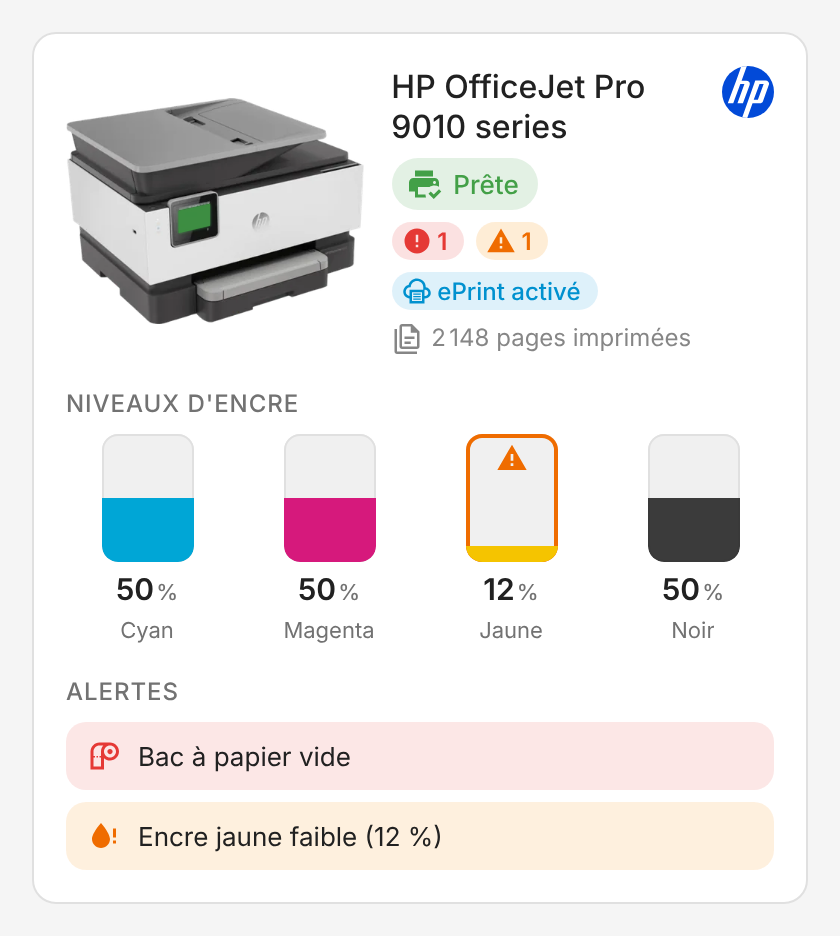
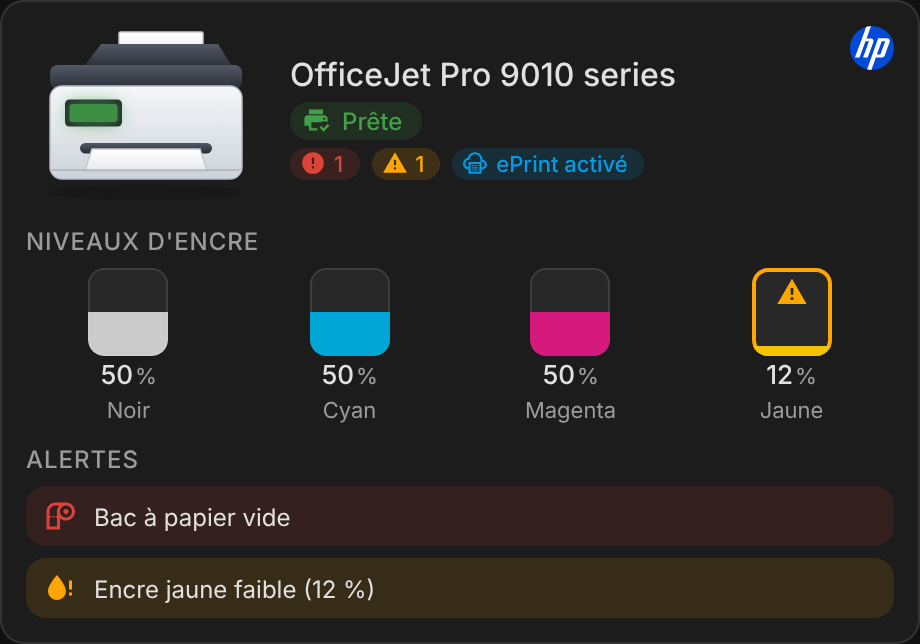
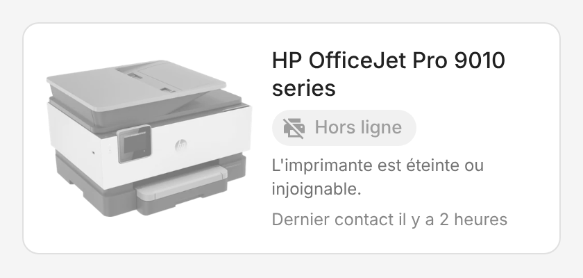
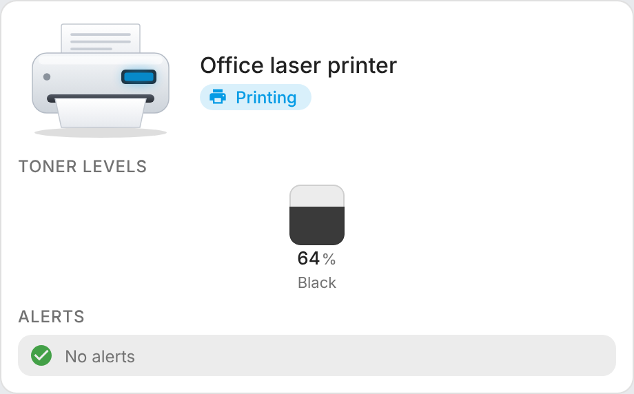
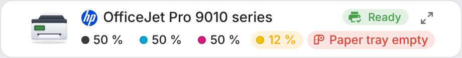
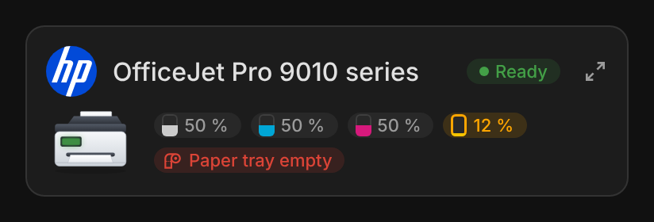
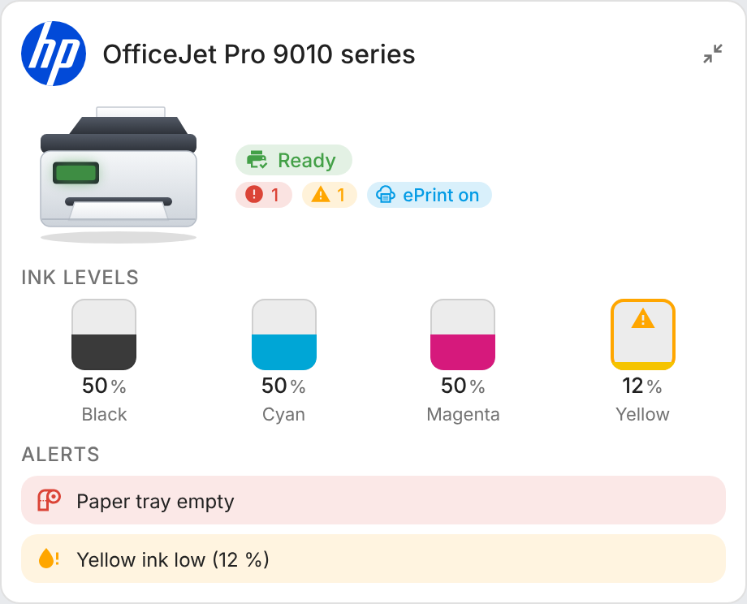
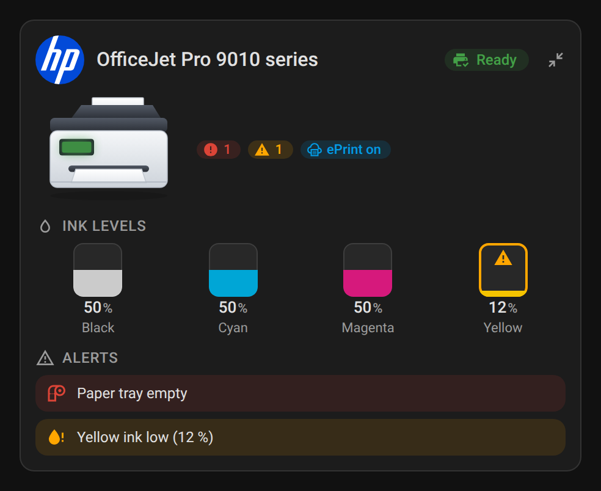
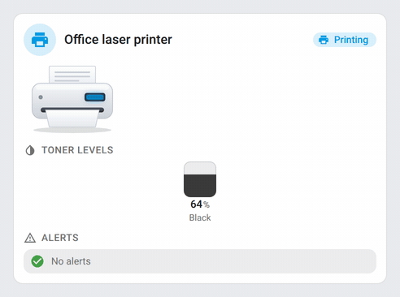

# ha-printer-card

[](https://github.com/hacs/integration)
[](https://github.com/juju35/ha-printer-card/actions/workflows/hacs.yml)
[](https://github.com/juju35/ha-printer-card/actions/workflows/validate.yml)
[](https://github.com/juju35/ha-printer-card/releases/latest)
[](LICENSE)

Custom Lovelace card for printers in Home Assistant: built for HP printers with the [HP Printer](https://github.com/elad-bar/ha-hpprinter) integration (`hpprinter`), and working with **any IPP printer** (Brother, Canon, Epson, Xerox…) through the core [IPP](https://www.home-assistant.io/integrations/ipp/) integration.

> Formerly `ha-hp-printer-card`: since 2.0.1, cards must use `type: custom:printer-card` (`custom:hp-printer-card` is no longer registered).

When the printer is off, the card simply says it's **offline**. Otherwise it shows the **status**, the **ink or toner levels** and the **alerts**.

Pick the printer, the card finds all its entities by itself. A compact **Printer Mini Card** shows the same printer on two lines, and its detail button opens the full card in place.

[](https://my.home-assistant.io/redirect/hacs_repository/?owner=juju35&repository=ha-printer-card&category=plugin)

| HP Printer | Dark theme | Offline | IPP printer (any brand) |
|---|---|---|---|
|  |  |  |  |

| Printer Mini Card | Mini card, full view (detail button) |
|---|---|
|  |  |

## Features

- **Offline state**: when the printer is turned off or unreachable, the picture turns grey and the card only shows *Offline* with the last time it was seen
- **Status** with color: ready, sleeping, printing, scanning, copying, cancelling, stopped. The printer's control panel lights up in the status color and pulses while it works
- **Ink or toner levels**: one tank per cartridge, in the printer's slot order, with a warning below a configurable threshold
- **Any IPP printer**: status, ink or toner levels and paper / cover alerts for printers of any brand through the IPP integration
- **Pictures**: a drawing per HP range (OfficeJet, LaserJet, DeskJet / ENVY, Smart Tank) and a generic printer for the other brands, picked from the device model or chosen in the editor
- **Alerts**: low or nearly empty ink, missing / used / non-HP / damaged cartridge, printhead problem, and, through the IPP integration, empty paper tray, paper jam, open cover…
- **ePrint status**: on, off or not registered (HP cloud printing)
- Page counter
- **Mini card**, laid out like the Home Connect mini cards: logo, name and status on top, then the picture with one chip per cartridge (a small tank at its level, outlined orange when low, red when nearly empty) and per alert
- **Detail button** on the mini card (top right): shows the full card in place, with everything it shows; the button, or a click anywhere else, goes back to the compact view. `zoom: false` removes it
- Automatic entity discovery from the device (works with English or French entity IDs), status, IPP sensor, ePrint sensors and page counter can be overridden
- Visual editor in the dashboard UI (no YAML needed)
- English and French, follows the Home Assistant language
- Light and dark theme compatible
- Single file, no dependencies, HACS-ready

## Prerequisites

- Home Assistant 2024.8 or later with the [HP Printer](https://github.com/elad-bar/ha-hpprinter) integration (recommended for HP printers) or the [IPP](https://www.home-assistant.io/integrations/ipp/) integration (any brand) set up
- With both integrations set up for the same printer, the card uses HP Printer for status and inks and picks up the IPP printer sensor by itself for paper and cover alerts

## Installation

### Via HACS (recommended)

Click the button below to add the repository directly:

[](https://my.home-assistant.io/redirect/hacs_repository/?owner=juju35&repository=ha-printer-card&category=plugin)

Or manually:

1. Open HACS → **Frontend** → **⋮** → **Custom repositories**
2. Add `https://github.com/juju35/ha-printer-card` — Category: **Dashboard** (Lovelace)
3. Search for **Printer Card** and install it
4. Clear your browser cache and refresh

HACS registers the dashboard resource for you.

### Manual

1. Download `printer-card.js` from the [latest release](https://github.com/juju35/ha-printer-card/releases/latest)
2. Copy it to `/config/www/printer-card.js`
3. Go to **Settings → Dashboards → Resources** → Add resource:
   - URL: `/local/printer-card.js`
   - Type: **JavaScript Module**
4. Clear your browser cache and refresh

## Configuration

### Visual editor

Add the card from the dashboard (**Add card** → **Printer Card** or **Printer Mini Card**). The first printer found is picked automatically; change it with the **Printer** field, then set the name, the picture, the sections to show and the low ink threshold. The **Entities (advanced)** panel lets you force an entity if auto-detection picks the wrong one. Options left at their default are not written to the YAML.

### Minimal

```yaml
type: custom:printer-card
device_id: e1146b5da5cdfee3f4b06c25b0c863a7
```

Use either `device_id` (what the visual editor writes) or `entity` (any entity of the printer's main device). With neither, the card uses the first printer it finds.

### Mini card

```yaml
type: custom:printer-mini-card
device_id: e1146b5da5cdfee3f4b06c25b0c863a7
zoom: true
```

The mini card takes the same options as the full card (they also apply to its full view), plus `zoom`. `show_inks` and `show_alerts` choose its chips; `show_image` and `show_logo` its picture and HP logo.

### Full options

```yaml
type: custom:printer-card
device_id: e1146b5da5cdfee3f4b06c25b0c863a7
name: Printer
show_image: true
show_logo: true
show_inks: true
show_alerts: true
show_stats: true
show_eprint: true
show_expired: false
low_threshold: 15
picture: auto
admin_url: http://printer.local
image: /local/my-printer.png
language: en
entities:
  status: sensor.hp_officejet_pro_9010_series_192_168_1_119_status
  ipp: sensor.hp_officejet_pro_9010_series
  total_pages: sensor.hp_officejet_pro_9010_series_192_168_1_119_printer_total_pages
  eprint: binary_sensor.hp_officejet_pro_9010_series_192_168_1_119_eprint_status
  eprint_registration: binary_sensor.hp_officejet_pro_9010_series_192_168_1_119_eprint_registered
```

### Options reference

| Option | Required | Default | Description |
|---|---|---|---|
| `device_id` | ❌* | Auto | Printer device (*or `entity`; the first printer found is used if both are missing) |
| `entity` | ❌ | — | Any entity of the printer's main device, used to find the device |
| `name` | ❌ | Device name | Card title |
| `show_image` | ❌ | `true` | Show the printer picture |
| `show_logo` | ❌ | `true` | Show the HP logo before the name (HP printers, not with the `generic` picture; clicking it opens hp.com), or a printer icon in its place otherwise |
| `show_inks` | ❌ | `true` | Show the ink or toner levels |
| `show_alerts` | ❌ | `true` | Show the alerts |
| `show_stats` | ❌ | `true` | Show the total page counter |
| `show_eprint` | ❌ | `true` | Show the ePrint status (HP Printer integration only) |
| `show_expired` | ❌ | `false` | Also alert when a cartridge's warranty date has passed |
| `low_threshold` | ❌ | `15` | Ink level (%) at or below which a cartridge is flagged as low; at 5 % or less it is nearly empty |
| `admin_url` | ❌ | Detected | Page opened when clicking the printer picture, e.g. `http://printer.local`. By default, the device's configuration URL or the address of its IPP sensor |
| `picture` | ❌ | `auto` | Picture: `auto`, `officejet`, `laserjet`, `deskjet`, `smart_tank` or `generic` (see below) |
| `image` | ❌ | — | URL of your own printer picture, e.g. `/local/printer.png`; replaces `picture` |
| `language` | ❌ | Auto | Force language: `fr` or `en` (auto-detects from HA settings) |
| `entities` | ❌ | Auto | Override detected entities (see below) |
| `zoom` | ❌ | `true` | Mini card only: detail button in the top right corner, showing the full card; a click on it or anywhere else goes back to the compact view. `false` removes it |

### Entity overrides

Keys accepted under `entities`:

| Key | Domain | Used for |
|---|---|---|
| `status` | `sensor` | Printer status (HP Printer *Status* sensor, or the IPP printer sensor) |
| `ipp` | `sensor` | IPP printer sensor, read for paper, jam and cover alerts |
| `total_pages` | `sensor` | Page counter |
| `eprint` | `binary_sensor` | ePrint status (on / off) |
| `eprint_registration` | `binary_sensor` | ePrint registration, shows *not registered* when off |

Cartridges are always found from the printer's devices.

### Pictures

| `picture` | Used by `auto` for |
|---|---|
| `officejet` | Other HP models (OfficeJet, PageWide…): all-in-one drawing |
| `laserjet` | HP LaserJet, Neverstop |
| `deskjet` | HP DeskJet, ENVY, Tango |
| `smart_tank` | HP Smart Tank, Ink Tank |
| `generic` | Printers of other brands (IPP) |

The control panel of each picture lights up in the status color.

## Screenshots

| Light | Dark (French) | Printer offline | IPP laser printer |
|---|---|---|---|
|  |  |  |  |

Mini card:

| | Light | Dark (French) |
|---|---|---|
| Compact |  |  |
| Offline |  |  |
| Full view |  |  |

While a job is printing, the card animates: the preview screen glows as pages advance. It settles to a still card when idle (and honours `prefers-reduced-motion`).



## How it works

The HP Printer integration creates one device per part of the printer (each cartridge, the printhead, the print, scan and copy counters) linked to the main device. The card reads the entity registry to list them, then for each cartridge finds its level, slot, status and warranty date. The printer is shown as **offline** when its status sensor reports `off` (that's what the integration does when the printer stops answering) or is unavailable.

With the IPP integration only (any brand), the card reads the printer sensor of the IPP device for the status and the `printer-state-reasons` alerts, and its marker sensors for the ink or toner levels. The HP logo (replaced by a printer icon) and the ePrint chip are only shown for HP printers.

Set `image` to use a photo of your own model (the lit control panel is only drawn on the bundled drawings).

## Development

```bash
npm install
npm run build        # stamps the version of package.json into dist/printer-card.js
npm run check        # builds and checks the card (run in CI)
npm run screenshots  # renders the cards with mock HP and IPP printers into screenshots/ (and printing.gif, needs ffmpeg)
```

`dist/` is not committed: `npm run build` creates it locally, CI builds it on every push, and the release workflow attaches the built file to the release, which is where HACS downloads it from.

### Releasing

1. Bump `version` in `package.json`
2. Add a `## <version>` section at the top of [CHANGELOG.md](CHANGELOG.md)
3. Push to `main`: the **Release** workflow builds the card, creates the tag and the GitHub release with the changelog section as notes, and attaches `printer-card.js`

## Translations

The card auto-detects the language from your Home Assistant settings. Currently supported:

| Language | Code |
|---|---|
| English | `en` |
| Français | `fr` |

Contributions for additional languages are welcome!

## License

[MIT](LICENSE)
